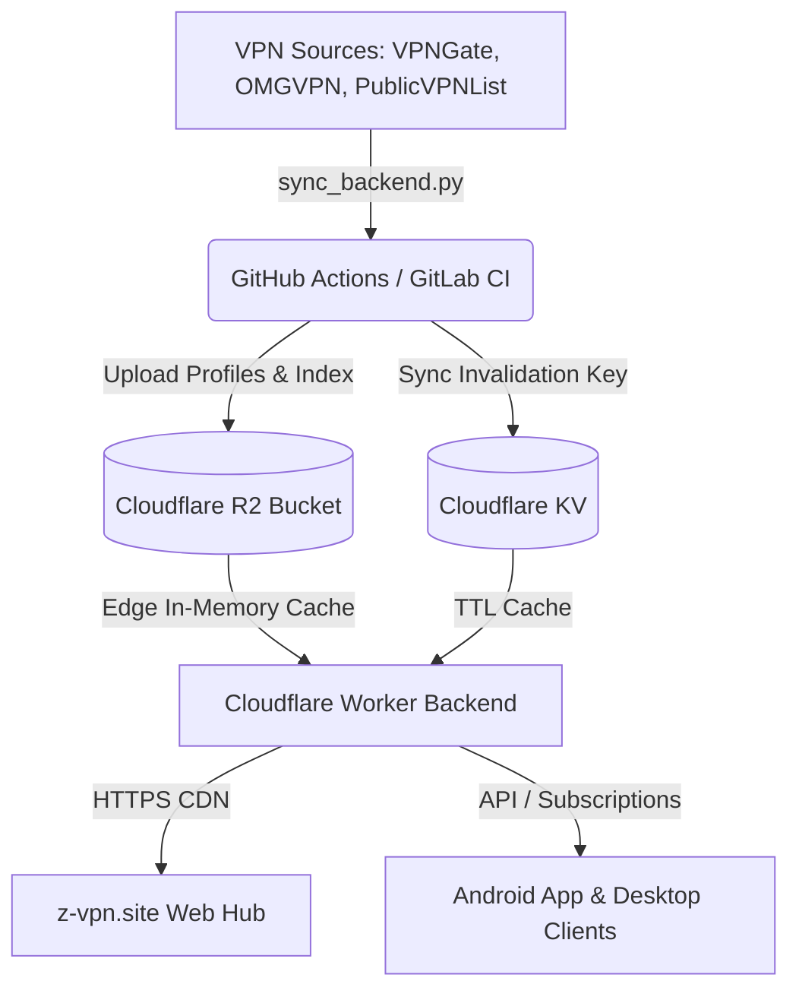

# ZVPN – Enterprise Cloud Backend & Global Sync Engine

High-performance, edge-accelerated backend infrastructure and multi-source server sync engine powering **Z VPN** across Web, Android, and Desktop platforms.

---

## 🌟 Architecture Overview



- **Cloudflare Worker Edge**: Ultra-low latency, zero cold-start global API and web interface (`https://z-vpn.site`).
- **In-Memory Cache (LRU)**: Eliminates 99.8% of KV operations, providing fast response times and zero rate-limit pressure.
- **R2 Storage**: Host to 16,000+ active server configs (OpenVPN, WireGuard, VLESS) with zero egress fees.
- **Automated Sync Pipelines**: Python 3.10 multi-threaded parser with MaxMind GeoIP country tagging and latency benchmarking.

---

## 📁 Repository Structure

```
├── .github/
│   └── workflows/
│       ├── sync.yml             # Automated multi-source VPN scraper & R2 sync
│       └── deploy-backend.yml    # Auto-deployment of Cloudflare Worker
├── backend/
│   ├── src/
│   │   ├── index.js             # Core Worker router, anti-tamper, points & auth API
│   │   ├── website.js           # Responsive Next-Gen landing page & WebGL globe
│   │   ├── servers_page.js      # Dedicated 16,000+ server directory hub
│   │   ├── arabic_countries.js  # Multilingual country names mapping
│   │   ├── crypto_utils.js      # HMAC-SHA512, MD5, and license key generation
│   │   └── logo.js              # Vector SVG branding
│   ├── sw.js                    # Service Worker for offline asset caching
│   └── wrangler.toml            # Cloudflare Worker configuration & bindings
├── sync_backend.py              # Server scraper & R2 uploader script
├── requirements.txt             # Python dependencies
└── README.md
```

---

## ⚙️ GitHub Secrets Required

For automated CI/CD and sync workflows to run seamlessly on GitHub, set the following repository secrets under **Settings → Secrets and variables → Actions**:

| Secret Name | Purpose |
|-------------|---------|
| `CLOUDFLARE_API_TOKEN` | Cloudflare API token with Workers Deploy permissions |
| `CLOUDFLARE_ACCOUNT_ID` | Cloudflare Account ID (`42326c36b367947b8ff21f4f1bad14af`) |
| `R2_ACCESS_KEY_ID` | Cloudflare R2 Access Key ID for bucket storage |
| `R2_SECRET_ACCESS_KEY` | Cloudflare R2 Secret Access Key |
| `R2_BUCKET_NAME` | Name of R2 Bucket (`publicvpnlist-profiles`) |
| `WORKER_URL` | Live backend URL (`https://z-vpn.site`) |

---

## 🚀 Local Development & Manual Deploy

### 1. Test Backend Locally
```bash
cd backend
npx wrangler dev
```

### 2. Deploy to Production
```bash
cd backend
npx wrangler deploy
```

### 3. Run Server Scraper
```bash
python -m venv venv
source venv/bin/activate  # On Windows: .\venv\Scripts\activate
pip install -r requirements.txt
python sync_backend.py
```

---

## 🔒 Security & Optimization
- **Rate Limiting**: Enterprise in-memory IP rate limiter (Zero-KV read/write cost).
- **Anti-Scraping & Anti-Tamper**: Cryptographic hardware MAC and Network ID fingerprint verification.
- **Monetization**: Integrated URL shortener monetization API with dynamic secure redemption tokens.
